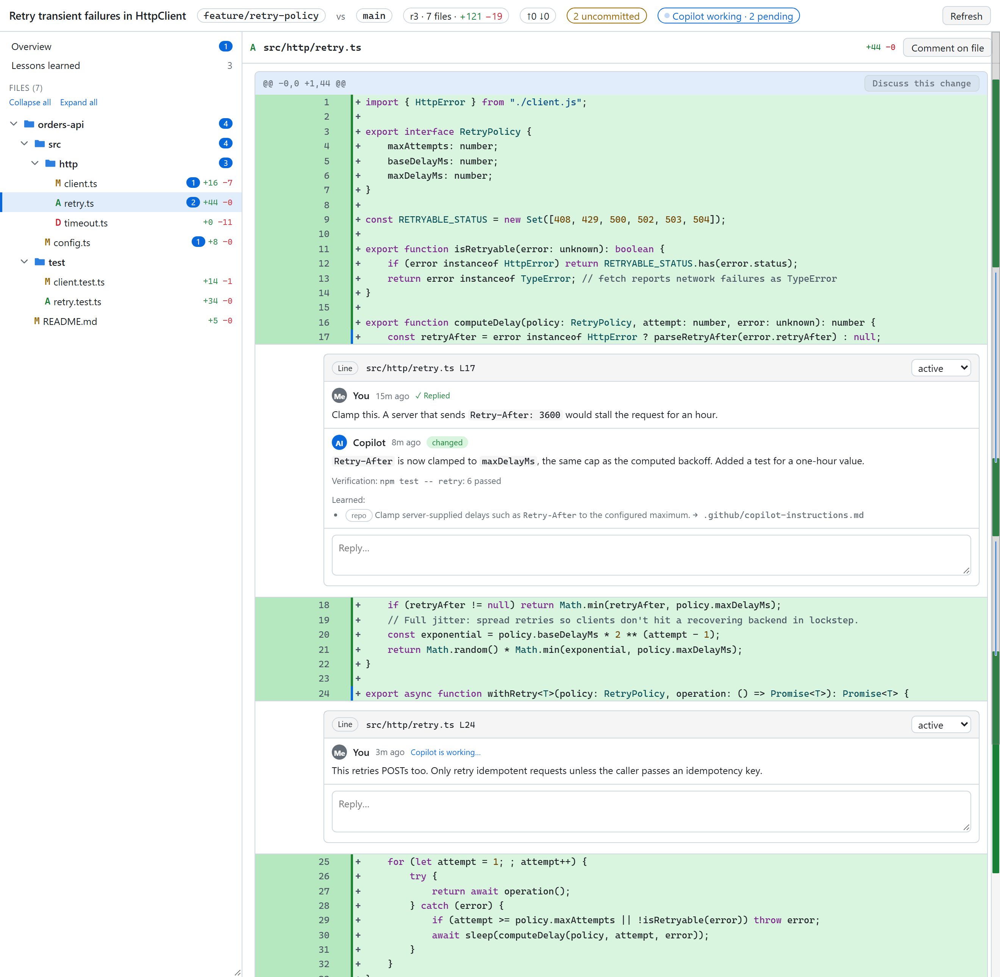
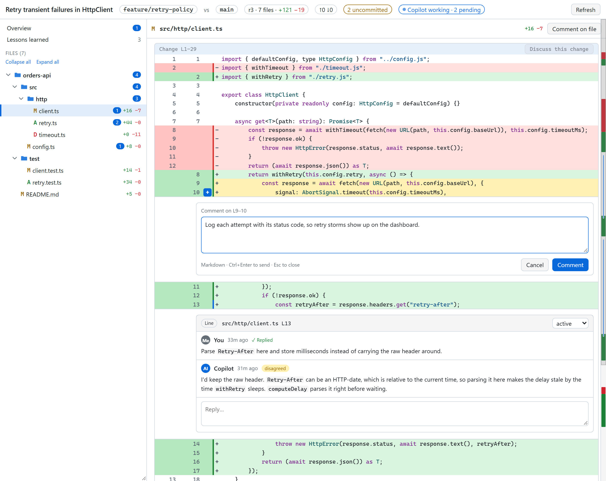
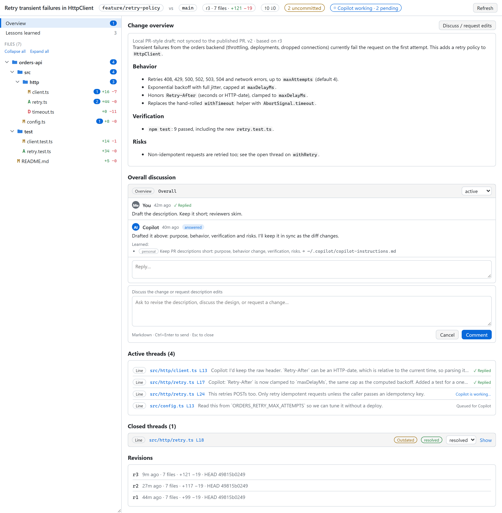
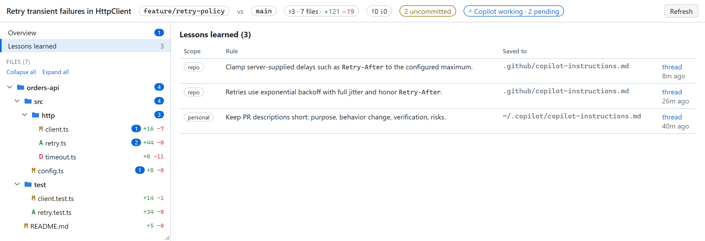

# Manual Review Canvas

**Review your agent's changes like a PR, before there is a PR.** A canvas and skill for the GitHub Copilot app.

```bash
copilot plugin marketplace add SergeyTeplyakov/ManualReviewCanvas
copilot plugin install manual-review-canvas@manual-review-canvas
```

In the Copilot app, [open this link](ghapp://plugins/install?source=manual-review-canvas%40manual-review-canvas&marketplace=SergeyTeplyakov%2FManualReviewCanvas). It asks you to confirm adding the `SergeyTeplyakov/ManualReviewCanvas` marketplace and installing `manual-review-canvas@manual-review-canvas`, then opens the install form pre-filled. Click Install to finish.

Or do it by hand: **Customize → + Add → Marketplace** with `SergeyTeplyakov/ManualReviewCanvas`, then **+ Add → Plugin** with `manual-review-canvas@manual-review-canvas`.

Start a new session in a repository with some changes and try:

```text
Open my changes against origin/main in the manual review canvas. Don't change anything until I comment.
```

You get a side-by-side review of your local changes. Select a line, write a comment, click **Comment**, and the agent picks it up in the same conversation, fixes it or answers, and replies in the thread.

## Why

Agents write code faster than you can read it. Reviewing in chat is awkward: you paste file names and line numbers, describe which `if` you mean, and lose track of what was already addressed. PR tools have the right shape for this, but they only kick in after you push, and their comments go to people, not to the agent that wrote the code.

Manual Review Canvas brings the PR review loop to your working tree. You read the diff and decide what matters. Each comment goes to the agent with the exact file, side, line range, and surrounding hunk. The agent fixes or answers, replies in the thread, and the diff refreshes. Nothing is pushed, published, or committed unless you ask for it.

Every comment is also treated as a coding guideline. The agent turns it into a rule, saves it to your repository instructions (or proposes a personal one), and tells you where it went, so you don't have to make the same comment twice.

## What it looks like

Threads sit next to the code they're about. The agent replies with what it changed, how it verified it, and the guideline it saved. The top bar shows when the agent is still working.

<picture>
  <source media="(prefers-color-scheme: dark)" srcset="docs/images/conversation-dark.png">
  
</picture>

Select lines on either side of the diff to start a thread.

<picture>
  <source media="(prefers-color-scheme: dark)" srcset="docs/images/comment-dark.png">
  
</picture>

The overview has the PR-style description the agent drafted, the overall discussion, every thread with its delivery state, and the revision history.

<picture>
  <source media="(prefers-color-scheme: dark)" srcset="docs/images/overview-dark.png">
  
</picture>

Guidelines saved from your comments are collected in one place, with where each one went.

<picture>
  <source media="(prefers-color-scheme: dark)" srcset="docs/images/lessons-dark.png">
  
</picture>

## How it works

- **Scope.** The review compares your working tree, including staged, unstaged, and untracked files, against the merge base with a base ref (`origin/HEAD`, `main`, or `master` by default). Narrow it to paths or exclude files when you open it.
- **Comments.** Start a thread on the overview, a file, a change, or a line range on either side of the diff. Selecting a file shows the whole file with changes inline; selecting a folder shows only the diffs under it.
- **Delivery.** Posting a comment starts a turn in the conversation that owns the canvas. Its state is visible on the thread: saving, queued, processing, replied, no reply (the agent finished without answering), or failed, with a resend for the last two. A comment is never shown as delivered just because you clicked a button.
- **Replies.** The agent answers in the thread with an outcome (answered, changed, blocked, disagreed, or needs input), how it verified the change, and any guideline it saved.
- **Refresh.** When the agent goes idle, the canvas captures a new revision. Threads follow their code when lines shift. If the commented code is gone, the thread keeps the original snippet and is marked outdated, not resolved.
- **Statuses.** Threads are active, resolved, won't fix, or closed. You decide when something is resolved, or tell the agent to resolve threads it has addressed.
- **Local only.** The canvas is served from `127.0.0.1` with a per-panel token. Reviews are stored in `~/.copilot/extension-data/manual-review`. Nothing is uploaded anywhere.

## What's inside

| Path | What it is |
|------|------------|
| [`extensions/manual-review/`](extensions/manual-review/) | The canvas: diff view, threads, comment delivery, and the actions the agent uses to reply. |
| [`skills/manual-review/`](skills/manual-review/) | The skill that tells the agent how to run the review loop: open the right comparison, process comments, reply, and capture guidelines. |

Canvases are a GitHub Copilot app feature. The skill loads in Copilot CLI too, but without the canvas there is nothing to comment on.

## Updating

```bash
copilot plugin update manual-review-canvas@manual-review-canvas
```

Then start a new session.

## Hacking on it

Clone the repo, then run `copilot plugin marketplace add <path-to-clone>` and `copilot plugin install manual-review-canvas@manual-review-canvas`. It loads straight from your checkout, so edits show up in your next session.

Run the tests from `extensions/manual-review`:

```bash
node --test test
```

The screenshots in this README come from a script that builds a demo repository, seeds a review, and captures the canvas in light and dark themes with Playwright, using your installed Edge or Chrome:

```bash
cd docs/screenshots
npm install
node render.mjs
```

Pass `--keep` to leave the demo review running and print its URL.

## Status

Early. Issues and PRs welcome.

## License

MIT. See [LICENSE](LICENSE).
